# SMVDU TITAN-X — Complete Hardware Dependency & Hierarchy Map

## Top-Level System Hierarchy (`titan_x_top`)
The top-level SoC integrates the complete RV64 multi-core complex, coherent memory subsystem, peripherals, and security Root-of-Trust:

```mermaid
graph TD
    titan_x_top["titan_x_top (SoC Root)"]
    
    titan_x_top --> u_core["4x Application Cores (rv_core_top)"]
    titan_x_top --> u_monitor["Core 4 Monitor (rv_monitor_core)"]
    titan_x_top --> u_crossbar["AXI4 Crossbar 10x8 (axi4_crossbar)"]
    titan_x_top --> u_l2_cache["L2 Cache Subsystem (l2_cache_top)"]
    titan_x_top --> u_ddr_ctrl["DDR4 Memory Controller (ddr_ctrl_top)"]
    titan_x_top --> u_plic["Platform-Level Interrupt Controller (plic)"]
    titan_x_top --> u_clint["Core Local Interruptor (clint)"]
    titan_x_top --> u_debug["JTAG 0.13 Debug Module (rv_debug)"]
    titan_x_top --> u_secure_boot["Hardware Root-of-Trust (secure_boot)"]
    titan_x_top --> u_envm["128KB eNVM Controller (envm_ctrl)"]
    titan_x_top --> u_axi2ahb["AXI4-to-AHB Bridge (axi4_to_ahb)"]
    titan_x_top --> u_ahb2apb["AHB-to-APB Bridge (ahb_to_apb)"]
    
    u_core --> rv_fetch["rv_fetch"]
    u_core --> rv_decode["rv_decode"]
    u_core --> rv_execute["rv_execute"]
    u_core --> rv_regfile["rv_regfile"]
    u_core --> rv_csr["rv_csr"]
    u_core --> rv_mem["rv_mem"]
    u_core --> rv_writeback["rv_writeback"]
    u_core --> rv_icache["L1 I-Cache (rv_icache)"]
    u_core --> rv_dcache["L1 D-Cache (rv_dcache)"]
    
    u_l2_cache --> l2_cache_ctrl["L2 Cache Controller (l2_cache_ctrl)"]
    u_l2_cache --> l2_snoop_filter["MESI Directory (l2_snoop_filter)"]
    u_l2_cache --> l2_tag_array["Tag Array (l2_tag_array)"]
    u_l2_cache --> l2_data_array["Data Array (l2_data_array)"]
    
    u_secure_boot --> sha256_engine["SHA-256 Engine (sha256_engine)"]
    u_secure_boot --> ecdsa_engine["ECDSA P-256 Engine (ecdsa_engine)"]
```

## Module Dependency Inventory
### `axi4_crossbar_formal`
- **Path**: `verification/formal/sva/axi4_crossbar_formal.sv`
- **Sub-Modules Instantiated**: `axi4_crossbar`

### `ddr_ctrl_top`
- **Path**: `memory/ddr_ctrl_top/ddr_ctrl_top.v`
- **Sub-Modules Instantiated**: `ddr_phy_if`, `ddr_scheduler`

### `debug_wdt`
- **Path**: `peripherals/watchdog_timer/debug_wdt.v`
- **Sub-Modules Instantiated**: `watchdog_timer`

### `debug_xbar`
- **Path**: `interconnect/axi4_crossbar/debug_xbar.v`
- **Sub-Modules Instantiated**: `axi4_crossbar`

### `l2_cache_top`
- **Path**: `memory/l2_cache_top/l2_cache_top.v`
- **Header Includes**: `params.vh`
- **Sub-Modules Instantiated**: `axi4_burst_to_lite`, `l2_cache_ctrl`, `l2_snoop_filter`

### `l2_data_array`
- **Path**: `memory/l2_data_array/l2_data_array.v`
- **Sub-Modules Instantiated**: `sram_32x64_180nm`

### `l2_snoop_filter`
- **Path**: `memory/l2_snoop_filter/l2_snoop_filter.v`
- **Header Includes**: `params.vh`

### `l2_snoop_filter_formal`
- **Path**: `verification/formal/sva/l2_snoop_filter_formal.sv`
- **Header Includes**: `params.vh`
- **Sub-Modules Instantiated**: `l2_snoop_filter`

### `pcie_top`
- **Path**: `peripherals/pcie_top/pcie_top.v`
- **Sub-Modules Instantiated**: `pcie_pipe_if`

### `rv_bpu`
- **Path**: `frontend/rv_bpu/rv_bpu.v`
- **Header Includes**: `params.vh`

### `rv_core_top`
- **Path**: `verification/coverage/annotated/rv_core_top.v`
- **Header Includes**: `params.vh`, `isa_pkg.vh`
- **Sub-Modules Instantiated**: `BUFX4`, `axi4_burst_to_lite`, `rv_dcache`, `rv_decode`, `rv_execute`, `rv_fetch`, `rv_icache`, `rv_mem`, `rv_writeback`

### `rv_csr`
- **Path**: `verification/coverage/annotated/rv_csr.v`
- **Header Includes**: `params.vh`, `isa_pkg.vh`

### `rv_dcache`
- **Path**: `backend/rv_dcache/rv_dcache.v`
- **Header Includes**: `params.vh`

### `rv_debug`
- **Path**: `backend/rv_debug/rv_debug.v`
- **Header Includes**: `params.vh`

### `rv_decode`
- **Path**: `verification/coverage/annotated/rv_decode.v`
- **Header Includes**: `isa_pkg.vh`
- **Sub-Modules Instantiated**: `BUFX4`, `rv_regfile`

### `rv_execute`
- **Path**: `verification/coverage/annotated/rv_execute.v`
- **Header Includes**: `params.vh`, `isa_pkg.vh`
- **Sub-Modules Instantiated**: `BUFX4`, `rv_csr`

### `rv_fetch`
- **Path**: `verification/coverage/annotated/rv_fetch.v`
- **Header Includes**: `params.vh`

### `rv_fetch_formal`
- **Path**: `verification/formal/sva/rv_fetch_formal.sv`
- **Header Includes**: `params.vh`
- **Sub-Modules Instantiated**: `rv_fetch`

### `rv_fpu`
- **Path**: `backend/rv_fpu/rv_fpu.v`
- **Header Includes**: `params.vh`, `isa_pkg.vh`

### `rv_icache`
- **Path**: `frontend/rv_icache/rv_icache.v`
- **Header Includes**: `params.vh`

### `rv_mmu`
- **Path**: `backend/rv_mmu/rv_mmu.v`
- **Header Includes**: `params.vh`, `isa_pkg.vh`
- **Sub-Modules Instantiated**: `rv_ptw`, `rv_tlb`

### `rv_monitor_core`
- **Path**: `backend/rv_monitor_core/rv_monitor_core.v`
- **Header Includes**: `params.vh`, `isa_pkg.vh`
- **Sub-Modules Instantiated**: `rv_decode`, `rv_execute`

### `rv_pmp`
- **Path**: `backend/rv_pmp/rv_pmp.v`
- **Header Includes**: `params.vh`, `isa_pkg.vh`

### `rv_ptw`
- **Path**: `backend/rv_ptw/rv_ptw.v`
- **Header Includes**: `params.vh`, `isa_pkg.vh`

### `rv_regfile_formal`
- **Path**: `verification/formal/sva/rv_regfile_formal.sv`
- **Sub-Modules Instantiated**: `rv_regfile`

### `rv_tlb`
- **Path**: `backend/rv_tlb/rv_tlb.v`
- **Header Includes**: `params.vh`, `isa_pkg.vh`

### `secure_boot`
- **Path**: `security/secure_boot/secure_boot.v`
- **Sub-Modules Instantiated**: `ecdsa_engine`, `sha256_engine`

### `secure_boot_formal`
- **Path**: `formal/sva/secure_boot_formal.sv`
- **Sub-Modules Instantiated**: `secure_boot`

### `tb_BUFX4`
- **Path**: `common/BUFX4/tb_BUFX4.v`
- **Sub-Modules Instantiated**: `BUFX4`

### `tb_aes_engine`
- **Path**: `peripherals/aes_engine/tb_aes_engine.v`
- **Sub-Modules Instantiated**: `aes_engine`

### `tb_ahb_to_apb`
- **Path**: `interconnect/ahb_to_apb/tb_ahb_to_apb.v`
- **Sub-Modules Instantiated**: `ahb_to_apb`

### `tb_apb_bridge`
- **Path**: `interconnect/apb_bridge/tb_apb_bridge.v`
- **Sub-Modules Instantiated**: `apb_bridge`

### `tb_axi4_burst_to_lite`
- **Path**: `interconnect/tb_axi4_burst_to_lite.v`
- **Sub-Modules Instantiated**: `axi4_burst_to_lite`

### `tb_axi4_crossbar`
- **Path**: `interconnect/axi4_crossbar/tb_axi4_crossbar.v`
- **Sub-Modules Instantiated**: `axi4_crossbar`

### `tb_axi4_to_ahb`
- **Path**: `interconnect/axi4_to_ahb/tb_axi4_to_ahb.v`
- **Sub-Modules Instantiated**: `axi4_to_ahb`

### `tb_axi_rom`
- **Path**: `top/axi_rom/tb_axi_rom.v`
- **Sub-Modules Instantiated**: `axi_rom`

### `tb_bfm_ddr4`
- **Path**: `integration/tb_bfm_ddr4.v`
- **Sub-Modules Instantiated**: `ddr4_sdram_bfm`, `ddr_ctrl_top`

### `tb_bfm_gmii`
- **Path**: `integration/tb_bfm_gmii.v`
- **Sub-Modules Instantiated**: `gem_ethernet`, `gmii_frame_gen`

### `tb_bfm_mipi`
- **Path**: `integration/tb_bfm_mipi.v`
- **Sub-Modules Instantiated**: `isp_pipeline`, `mipi_csi2_bfm`, `mipi_csi2_rx`

### `tb_bfm_pcie`
- **Path**: `integration/tb_bfm_pcie.v`
- **Sub-Modules Instantiated**: `pcie_rootport_bfm`, `pcie_top`

### `tb_can_controller`
- **Path**: `peripherals/can_controller/tb_can_controller.v`
- **Sub-Modules Instantiated**: `can_controller`

### `tb_cdc_sync`
- **Path**: `common/cdc_sync/tb_cdc_sync.v`
- **Sub-Modules Instantiated**: `cdc_sync`

### `tb_clint`
- **Path**: `backend/clint/tb_clint.v`
- **Sub-Modules Instantiated**: `clint`

### `tb_ddr_ctrl_top`
- **Path**: `memory/ddr_ctrl_top/tb_ddr_ctrl_top.v`
- **Sub-Modules Instantiated**: `ddr_ctrl_top`

### `tb_ddr_phy_if`
- **Path**: `memory/ddr_phy_if/tb_ddr_phy_if.v`
- **Sub-Modules Instantiated**: `ddr_phy_if`

### `tb_ddr_scheduler`
- **Path**: `memory/ddr_scheduler/tb_ddr_scheduler.v`
- **Sub-Modules Instantiated**: `ddr_scheduler`

### `tb_drbg`
- **Path**: `security/drbg/tb_drbg.v`
- **Sub-Modules Instantiated**: `drbg`

### `tb_ecdsa_engine`
- **Path**: `security/ecdsa_engine/tb_ecdsa_engine.v`
- **Sub-Modules Instantiated**: `ecdsa_engine`

### `tb_envm_ctrl`
- **Path**: `security/envm_ctrl/tb_envm_ctrl.v`
- **Sub-Modules Instantiated**: `envm_ctrl`

### `tb_fifo_async`
- **Path**: `common/fifo_async/tb_fifo_async.v`
- **Sub-Modules Instantiated**: `fifo_async`

### `tb_fifo_sync`
- **Path**: `common/fifo_sync/tb_fifo_sync.v`
- **Sub-Modules Instantiated**: `fifo_sync`

### `tb_fresh_clint`
- **Path**: `backend/clint/tb_fresh_clint.v`
- **Sub-Modules Instantiated**: `clint`

### `tb_fresh_plic`
- **Path**: `backend/plic/tb_fresh_plic.v`
- **Sub-Modules Instantiated**: `plic`

### `tb_fresh_rv_bpu`
- **Path**: `frontend/rv_bpu/tb_fresh_rv_bpu.v`
- **Header Includes**: `params.vh`
- **Sub-Modules Instantiated**: `rv_bpu`

### `tb_fresh_rv_core_top`
- **Path**: `backend/rv_core_top/tb_fresh_rv_core_top.v`
- **Header Includes**: `params.vh`, `isa_pkg.vh`
- **Sub-Modules Instantiated**: `rv_core_top`

### `tb_fresh_rv_csr`
- **Path**: `backend/rv_csr/tb_fresh_rv_csr.v`
- **Sub-Modules Instantiated**: `rv_csr`

### `tb_fresh_rv_dcache`
- **Path**: `backend/rv_dcache/tb_fresh_rv_dcache.v`
- **Header Includes**: `params.vh`
- **Sub-Modules Instantiated**: `rv_dcache`

### `tb_fresh_rv_debug`
- **Path**: `backend/rv_debug/tb_fresh_rv_debug.v`
- **Header Includes**: `params.vh`
- **Sub-Modules Instantiated**: `rv_debug`

### `tb_fresh_rv_decode`
- **Path**: `frontend/rv_decode/tb_fresh_rv_decode.v`
- **Header Includes**: `isa_pkg.vh`
- **Sub-Modules Instantiated**: `rv_decode`

### `tb_fresh_rv_execute`
- **Path**: `backend/rv_execute/tb_fresh_rv_execute.v`
- **Header Includes**: `params.vh`, `isa_pkg.vh`
- **Sub-Modules Instantiated**: `rv_execute`

### `tb_fresh_rv_fetch`
- **Path**: `frontend/rv_fetch/tb_fresh_rv_fetch.v`
- **Header Includes**: `params.vh`
- **Sub-Modules Instantiated**: `rv_fetch`

### `tb_fresh_rv_fpu`
- **Path**: `backend/rv_fpu/tb_fresh_rv_fpu.v`
- **Header Includes**: `params.vh`, `isa_pkg.vh`
- **Sub-Modules Instantiated**: `rv_fpu`

### `tb_fresh_rv_icache`
- **Path**: `frontend/rv_icache/tb_fresh_rv_icache.v`
- **Header Includes**: `params.vh`
- **Sub-Modules Instantiated**: `rv_icache`

### `tb_fresh_rv_mem`
- **Path**: `backend/rv_mem/tb_fresh_rv_mem.v`
- **Sub-Modules Instantiated**: `rv_mem`

### `tb_fresh_rv_mmu`
- **Path**: `backend/rv_mmu/tb_fresh_rv_mmu.v`
- **Header Includes**: `params.vh`, `isa_pkg.vh`
- **Sub-Modules Instantiated**: `rv_mmu`

### `tb_fresh_rv_monitor_core`
- **Path**: `backend/rv_monitor_core/tb_fresh_rv_monitor_core.v`
- **Sub-Modules Instantiated**: `rv_monitor_core`

### `tb_fresh_rv_pmp`
- **Path**: `backend/rv_pmp/tb_fresh_rv_pmp.v`
- **Header Includes**: `params.vh`, `isa_pkg.vh`
- **Sub-Modules Instantiated**: `rv_pmp`

### `tb_fresh_rv_ptw`
- **Path**: `backend/rv_ptw/tb_fresh_rv_ptw.v`
- **Header Includes**: `params.vh`, `isa_pkg.vh`
- **Sub-Modules Instantiated**: `rv_ptw`

### `tb_fresh_rv_regfile`
- **Path**: `backend/rv_regfile/tb_fresh_rv_regfile.v`
- **Sub-Modules Instantiated**: `rv_regfile`

### `tb_fresh_rv_tlb`
- **Path**: `backend/rv_tlb/tb_fresh_rv_tlb.v`
- **Header Includes**: `params.vh`, `isa_pkg.vh`
- **Sub-Modules Instantiated**: `rv_tlb`

### `tb_fresh_rv_writeback`
- **Path**: `backend/rv_writeback/tb_fresh_rv_writeback.v`
- **Sub-Modules Instantiated**: `rv_writeback`

### `tb_fresh_titan_x_top`
- **Path**: `top/titan_x_top/tb_fresh_titan_x_top.v`
- **Sub-Modules Instantiated**: `titan_x_top`

### `tb_gem_ethernet`
- **Path**: `peripherals/gem_ethernet/tb_gem_ethernet.v`
- **Sub-Modules Instantiated**: `gem_ethernet`

### `tb_gem_sgmii_pcs`
- **Path**: `peripherals/gem_sgmii_pcs/tb_gem_sgmii_pcs.v`
- **Sub-Modules Instantiated**: `gem_sgmii_pcs`

### `tb_gpio_ctrl`
- **Path**: `peripherals/gpio_ctrl/tb_gpio_ctrl.v`
- **Sub-Modules Instantiated**: `gpio_ctrl`

### `tb_hdmi_ctrl`
- **Path**: `video/hdmi_ctrl/tb_hdmi_ctrl.v`
- **Sub-Modules Instantiated**: `hdmi_ctrl`

### `tb_i2c_master`
- **Path**: `peripherals/i2c_master/tb_i2c_master.v`
- **Sub-Modules Instantiated**: `i2c_master`

### `tb_integ_memory_hierarchy`
- **Path**: `integration/tb_integ_memory_hierarchy.v`
- **Header Includes**: `tb_bfms.vh`, `tb_macros.vh`
- **Sub-Modules Instantiated**: `axi4_crossbar`, `ddr4_sdram_bfm`, `ddr_ctrl_top`

### `tb_integ_multicore_mesi`
- **Path**: `top/titan_x_top/tb_integ_multicore_mesi.v`
- **Header Includes**: `tb_bfms.vh`, `tb_macros.vh`
- **Sub-Modules Instantiated**: `axi4_crossbar`, `ddr4_sdram_bfm`, `ddr_ctrl_top`, `l2_cache_top`

### `tb_integ_peripheral_bus`
- **Path**: `integration/tb_integ_peripheral_bus.v`
- **Sub-Modules Instantiated**: `axi4_to_ahb`, `rtc`, `uart_16550`

### `tb_integ_peripherals`
- **Path**: `top/titan_x_top/tb_integ_peripherals.v`
- **Sub-Modules Instantiated**: `ddr4_sdram_bfm`, `mmc_controller`, `qspi_controller`, `titan_x_top`, `vdma`

### `tb_integ_security_chain`
- **Path**: `integration/tb_integ_security_chain.v`
- **Header Includes**: `tb_bfms.vh`, `tb_macros.vh`
- **Sub-Modules Instantiated**: `drbg`, `secure_boot`

### `tb_integ_video_pipeline`
- **Path**: `integration/tb_integ_video_pipeline.v`
- **Sub-Modules Instantiated**: `hdmi_ctrl`, `isp_pipeline`, `mipi_csi2_rx`

### `tb_integ_xbar_concurrency`
- **Path**: `integration/tb_integ_xbar_concurrency.v`
- **Header Includes**: `tb_bfms.vh`, `tb_macros.vh`
- **Sub-Modules Instantiated**: `axi4_crossbar`

### `tb_interconnect_mpu`
- **Path**: `interconnect/interconnect_mpu/tb_interconnect_mpu.v`
- **Sub-Modules Instantiated**: `interconnect_mpu`

### `tb_isp_pipeline`
- **Path**: `video/isp_pipeline/tb_isp_pipeline.v`
- **Sub-Modules Instantiated**: `isp_pipeline`

### `tb_l2_cache_ctrl`
- **Path**: `memory/l2_cache_ctrl/tb_l2_cache_ctrl.v`
- **Header Includes**: `tb_macros.vh`
- **Sub-Modules Instantiated**: `l2_cache_ctrl`

### `tb_l2_cache_top`
- **Path**: `memory/l2_cache_top/tb_l2_cache_top.v`
- **Header Includes**: `tb_macros.vh`
- **Sub-Modules Instantiated**: `l2_cache_top`

### `tb_l2_data_array`
- **Path**: `memory/l2_data_array/tb_l2_data_array.v`
- **Sub-Modules Instantiated**: `l2_data_array`

### `tb_l2_snoop_filter`
- **Path**: `memory/l2_snoop_filter/tb_l2_snoop_filter.v`
- **Sub-Modules Instantiated**: `l2_snoop_filter`

### `tb_l2_tag_array`
- **Path**: `memory/l2_tag_array/tb_l2_tag_array.v`
- **Sub-Modules Instantiated**: `l2_tag_array`

### `tb_mipi_csi2_rx`
- **Path**: `video/mipi_csi2_rx/tb_mipi_csi2_rx.v`
- **Sub-Modules Instantiated**: `mipi_csi2_rx`

### `tb_mmc_controller`
- **Path**: `storage/mmc_controller/tb_mmc_controller.v`
- **Sub-Modules Instantiated**: `mmc_controller`

### `tb_mmu_arbiter`
- **Path**: `interconnect/mmu_arbiter/tb_mmu_arbiter.v`
- **Sub-Modules Instantiated**: `mmu_arbiter`

### `tb_multicore_coherence`
- **Path**: `integration/tb_multicore_coherence.v`
- **Header Includes**: `tb_bfms.vh`, `tb_macros.vh`
- **Sub-Modules Instantiated**: `axi4_crossbar`, `ddr4_sdram_bfm`, `ddr_ctrl_top`, `l2_cache_top`

### `tb_pcie_pipe_if`
- **Path**: `peripherals/pcie_pipe_if/tb_pcie_pipe_if.v`
- **Sub-Modules Instantiated**: `pcie_pipe_if`

### `tb_pcie_top`
- **Path**: `peripherals/pcie_top/tb_pcie_top.v`
- **Sub-Modules Instantiated**: `pcie_top`

### `tb_plic`
- **Path**: `backend/plic/tb_plic.v`
- **Sub-Modules Instantiated**: `plic`

### `tb_power_aware_clock_gate`
- **Path**: `verification/coverage/tb_power_aware_clock_gate.v`
- **Sub-Modules Instantiated**: `ICGX4`

### `tb_qos_controller`
- **Path**: `interconnect/qos_controller/tb_qos_controller.v`
- **Sub-Modules Instantiated**: `qos_controller`

### `tb_qspi_controller`
- **Path**: `storage/qspi_controller/tb_qspi_controller.v`
- **Sub-Modules Instantiated**: `qspi_controller`

### `tb_reset_sync`
- **Path**: `common/reset_sync/tb_reset_sync.v`
- **Sub-Modules Instantiated**: `reset_sync`

### `tb_rtc`
- **Path**: `peripherals/rtc/tb_rtc.v`
- **Sub-Modules Instantiated**: `rtc`

### `tb_rv_bpu`
- **Path**: `frontend/rv_bpu/tb_rv_bpu.v`
- **Sub-Modules Instantiated**: `rv_bpu`

### `tb_rv_core_compliance`
- **Path**: `backend/rv_core_top/tb_rv_core_compliance.v`
- **Memory Initializations**: `backend/rv_core_top/tb_compliance_imem.hex`, `backend/rv_core_top/tb_compliance_expected_regs.mem`, `backend/rv_core_top/tb_compliance_expected_maddr.mem`, `backend/rv_core_top/tb_compliance_expected_mval.mem`, `backend/rv_core_top/tb_compliance_expected_meta.mem`
- **Sub-Modules Instantiated**: `rv_core_top`

### `tb_rv_core_csr`
- **Path**: `backend/rv_core_top/tb_rv_core_csr.v`
- **Memory Initializations**: `backend/rv_core_top/tb_csr_imem.hex`, `backend/rv_core_top/tb_csr_expected_regs.mem`, `backend/rv_core_top/tb_csr_expected_maddr.mem`, `backend/rv_core_top/tb_csr_expected_mval.mem`, `backend/rv_core_top/tb_csr_expected_meta.mem`
- **Sub-Modules Instantiated**: `rv_core_top`

### `tb_rv_core_exception`
- **Path**: `backend/rv_core_top/tb_rv_core_exception.v`
- **Sub-Modules Instantiated**: `rv_core_top`

### `tb_rv_core_irq`
- **Path**: `backend/rv_core_top/tb_rv_core_irq.v`
- **Memory Initializations**: `backend/rv_core_top/tb_irq_imem.hex`, `backend/rv_core_top/tb_irq_expected_regs.mem`, `backend/rv_core_top/tb_irq_expected_maddr.mem`, `backend/rv_core_top/tb_irq_expected_mval.mem`, `backend/rv_core_top/tb_irq_expected_meta.mem`
- **Sub-Modules Instantiated**: `rv_core_top`

### `tb_rv_core_l1_cache`
- **Path**: `backend/rv_core_top/tb_rv_core_l1_cache.v`
- **Sub-Modules Instantiated**: `rv_core_top`

### `tb_rv_core_mext`
- **Path**: `backend/rv_core_top/tb_rv_core_mext.v`
- **Memory Initializations**: `backend/rv_core_top/tb_mext_imem.hex`, `backend/rv_core_top/tb_mext_expected_regs.mem`, `backend/rv_core_top/tb_mext_expected_maddr.mem`, `backend/rv_core_top/tb_mext_expected_mval.mem`, `backend/rv_core_top/tb_mext_expected_meta.mem`
- **Sub-Modules Instantiated**: `rv_core_top`

### `tb_rv_core_top`
- **Path**: `backend/rv_core_top/tb_rv_core_top.v`
- **Memory Initializations**: `backend/rv_core_top/tb_imem.hex`, `backend/rv_core_top/tb_expected_regs.mem`, `backend/rv_core_top/tb_expected_maddr.mem`, `backend/rv_core_top/tb_expected_mval.mem`, `backend/rv_core_top/tb_expected_meta.mem`
- **Sub-Modules Instantiated**: `rv_core_top`

### `tb_rv_core_traps_comprehensive`
- **Path**: `backend/rv_core_top/tb_rv_core_traps_comprehensive.v`
- **Sub-Modules Instantiated**: `rv_core_top`

### `tb_rv_core_wops`
- **Path**: `backend/rv_core_top/tb_rv_core_wops.v`
- **Memory Initializations**: `backend/rv_core_top/tb_wops_imem.hex`, `backend/rv_core_top/tb_wops_expected_regs.mem`, `backend/rv_core_top/tb_wops_expected_maddr.mem`, `backend/rv_core_top/tb_wops_expected_mval.mem`, `backend/rv_core_top/tb_wops_expected_meta.mem`
- **Sub-Modules Instantiated**: `rv_core_top`

### `tb_rv_csr`
- **Path**: `backend/rv_csr/tb_rv_csr.v`
- **Header Includes**: `params.vh`, `isa_pkg.vh`
- **Sub-Modules Instantiated**: `rv_csr`

### `tb_rv_dcache`
- **Path**: `backend/rv_dcache/tb_rv_dcache.v`
- **Sub-Modules Instantiated**: `rv_dcache`

### `tb_rv_debug`
- **Path**: `backend/rv_debug/tb_rv_debug.v`
- **Header Includes**: `isa_pkg.vh`
- **Sub-Modules Instantiated**: `rv_debug`

### `tb_rv_decode`
- **Path**: `frontend/rv_decode/tb_rv_decode.v`
- **Header Includes**: `isa_pkg.vh`
- **Sub-Modules Instantiated**: `rv_decode`

### `tb_rv_execute`
- **Path**: `backend/rv_execute/tb_rv_execute.v`
- **Header Includes**: `isa_pkg.vh`
- **Sub-Modules Instantiated**: `rv_execute`

### `tb_rv_fetch`
- **Path**: `frontend/rv_fetch/tb_rv_fetch.v`
- **Sub-Modules Instantiated**: `rv_fetch`

### `tb_rv_fpu`
- **Path**: `backend/rv_fpu/tb_rv_fpu.v`
- **Header Includes**: `isa_pkg.vh`
- **Sub-Modules Instantiated**: `rv_fpu`

### `tb_rv_icache`
- **Path**: `frontend/rv_icache/tb_rv_icache.v`
- **Sub-Modules Instantiated**: `rv_icache`

### `tb_rv_mem`
- **Path**: `backend/rv_mem/tb_rv_mem.v`
- **Sub-Modules Instantiated**: `rv_mem`

### `tb_rv_mmu`
- **Path**: `backend/rv_mmu/tb_rv_mmu.v`
- **Sub-Modules Instantiated**: `rv_mmu`

### `tb_rv_monitor_core`
- **Path**: `backend/rv_monitor_core/tb_rv_monitor_core.v`
- **Sub-Modules Instantiated**: `rv_monitor_core`

### `tb_rv_pmp`
- **Path**: `backend/rv_pmp/tb_rv_pmp.v`
- **Sub-Modules Instantiated**: `rv_pmp`

### `tb_rv_ptw`
- **Path**: `backend/rv_ptw/tb_rv_ptw.v`
- **Sub-Modules Instantiated**: `rv_ptw`

### `tb_rv_regfile`
- **Path**: `backend/rv_regfile/tb_rv_regfile.v`
- **Sub-Modules Instantiated**: `rv_regfile`

### `tb_rv_tlb`
- **Path**: `backend/rv_tlb/tb_rv_tlb.v`
- **Sub-Modules Instantiated**: `rv_tlb`

### `tb_rv_writeback`
- **Path**: `backend/rv_writeback/tb_rv_writeback.v`
- **Sub-Modules Instantiated**: `rv_writeback`

### `tb_secure_boot`
- **Path**: `security/secure_boot/tb_secure_boot.v`
- **Sub-Modules Instantiated**: `secure_boot`

### `tb_secure_boot_crypto`
- **Path**: `security/secure_boot/tb_secure_boot_crypto.v`
- **Sub-Modules Instantiated**: `secure_boot`

### `tb_sha256_engine`
- **Path**: `peripherals/sha256_engine/tb_sha256_engine.v`
- **Sub-Modules Instantiated**: `sha256_engine`

### `tb_spi_master`
- **Path**: `peripherals/spi_master/tb_spi_master.v`
- **Sub-Modules Instantiated**: `spi_master`

### `tb_sram_32x64_180nm`
- **Path**: `memory/sram_32x64_180nm/tb_sram_32x64_180nm.v`
- **Sub-Modules Instantiated**: `sram_32x64_180nm`

### `tb_sram_512kx8_180nm`
- **Path**: `memory/sram_512kx8_180nm/tb_sram_512kx8_180nm.v`
- **Sub-Modules Instantiated**: `sram_512kx8_180nm`

### `tb_stdcell_stubs`
- **Path**: `includes/tb_stdcell_stubs.v`
- **Sub-Modules Instantiated**: `BUFX4`

### `tb_titan_x_performance`
- **Path**: `verification/performance/tb_titan_x_performance.v`
- **Sub-Modules Instantiated**: `titan_x_top`

### `tb_titan_x_top`
- **Path**: `verification/tb_titan_x_top.sv`
- **Sub-Modules Instantiated**: `titan_x_top`

### `tb_trng`
- **Path**: `peripherals/trng/tb_trng.v`
- **Sub-Modules Instantiated**: `trng`

### `tb_uart_16550`
- **Path**: `peripherals/uart_16550/tb_uart_16550.v`
- **Sub-Modules Instantiated**: `uart_16550`

### `tb_unit_apb_bridge`
- **Path**: `interconnect/apb_bridge/tb_unit_apb_bridge.v`
- **Header Includes**: `tb_bfms.vh`, `tb_macros.vh`
- **Sub-Modules Instantiated**: `apb_bridge`

### `tb_usb_otg`
- **Path**: `storage/usb_otg/tb_usb_otg.v`
- **Sub-Modules Instantiated**: `usb_otg`

### `tb_uvm_top`
- **Path**: `verification/uvm_env/tests/tb_uvm_top.sv`
- **Sub-Modules Instantiated**: `axi4_crossbar`, `titan_x_env`

### `tb_vdma`
- **Path**: `video/vdma/tb_vdma.v`
- **Sub-Modules Instantiated**: `vdma`

### `tb_watchdog_timer`
- **Path**: `peripherals/watchdog_timer/tb_watchdog_timer.v`
- **Sub-Modules Instantiated**: `watchdog_timer`

### `titan_x_env`
- **Path**: `verification/uvm_env/env/titan_x_env.sv`
- **Sub-Modules Instantiated**: `axi_driver`, `axi_monitor`, `titan_x_scoreboard`

### `titan_x_top`
- **Path**: `top/titan_x_top/titan_x_top.v`
- **Sub-Modules Instantiated**: `aes_engine`, `axi4_crossbar`, `axi4_to_ahb`, `axi_rom`, `can_controller`, `clint`, `ddr_ctrl_top`, `drbg`, `ecdsa_engine`, `envm_ctrl`, `gem_ethernet`, `gpio_ctrl`, `hdmi_ctrl`, `i2c_master`, `interconnect_mpu`, `isp_pipeline`, `l2_cache_top`, `mipi_csi2_rx`, `mmc_controller`, `mmu_arbiter`, `pcie_top`, `plic`, `qos_controller`, `qspi_controller`, `rtc`, `rv_core_top`, `rv_debug`, `rv_monitor_core`, `secure_boot`, `sha256_engine`, `spi_master`, `trng`, `uart_16550`, `usb_otg`, `vdma`, `watchdog_timer`

